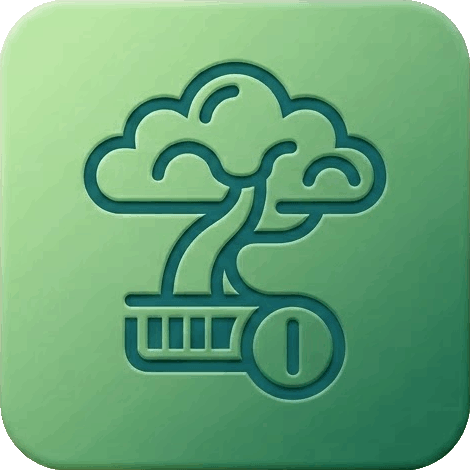
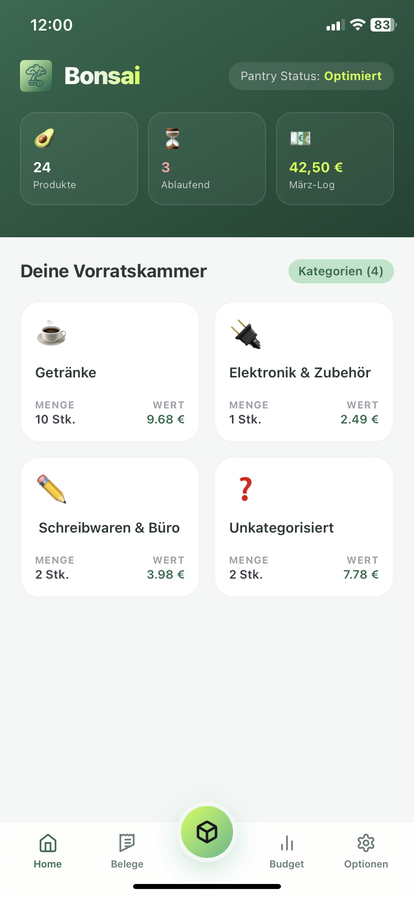
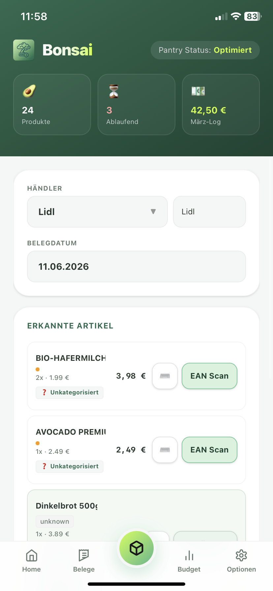
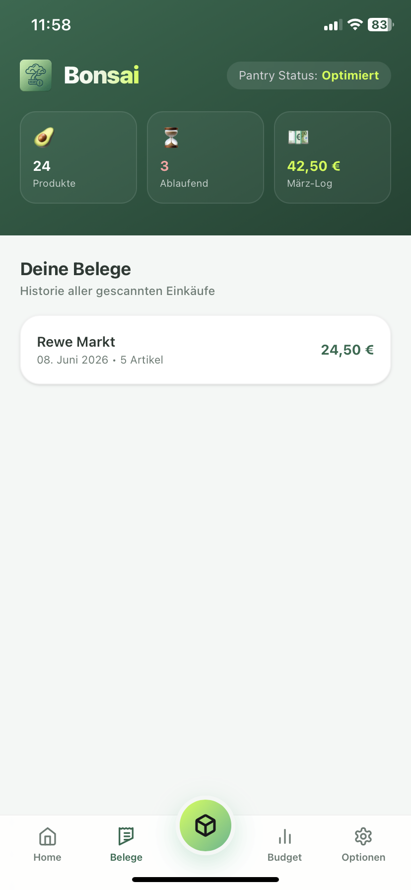

<div align="center">
  

# Bonsai

**Keep your pantry and purchases perfectly trimmed.**

Smart receipt scanning, barcode tracking, pantry management, and budgeting — all running locally.

<table>
  <tr>
    <td></td>
    <td></td>
    <td></td>
  </tr>
</table>

<p align="center">
  Dashboard • Scanner • Receipts
</p>

<p>
  
  
  
  
  
</p>

</div>

---

Bonsai is a privacy-friendly, open source Progressive Web App (PWA) and `axum` backend for managing groceries, pantry stock, and household expenses.

By scanning receipts and EAN barcodes, Bonsai automatically builds and maintains a digital pantry, tracks inventory levels, enriches products with nutritional information, and keeps an expense log in the background.

Everything runs locally and can be self-hosted.

---

> [!CAUTION]
> **Work in Progress (WIP)**
>
> This project is currently in a very early development stage. Features might change drastically, break unexpectedly, or remain incomplete. Use with caution!

---

## Features

* 📄 Receipt scanning using local Vision Language Models (VLMs)
* 📦 Automatic pantry management
* 🔍 EAN barcode scanning and lookup
* 🥗 Nutritional information support
* 💰 Household expense tracking
* 📱 Installable Progressive Web App (PWA)
* 🔒 Self-hosted and privacy-friendly

---

## Architecture

* **Frontend**: Vue 3, Vite, Pinia, Tailwind CSS 4, ZXing (barcode scanning)
* **Backend**: Axum 0.8, sqlx (SQLite), OpenCV (image preprocessing), argon2 (password hashing), JWT (session tokens)
* **Auth**: Registration and login via JWT stored in HTTP-only, secure, SameSite cookies
* **Ollama**: Local VLM (`qwen2.5vl:3b`) extracts receipt data as structured JSON

---

## Table of Contents

* [Installation](#installation)
  * [System Dependencies](#system-dependencies)
  * [TLS Certificates](#tls-certificates)
  * [Ollama Setup](#ollama-setup)
* [Configuration](#configuration)
* [Running Bonsai](#running-bonsai)
* [Commands Reference](#commands-reference)

---

# Installation

## System Dependencies

```bash
sudo xbps-install -y \
    cargo \
    llvm \
    libclang \
    libopencv-devel \
    nodejs
```

> [!NOTE]
> The Rust OpenCV bindings expect `libclang.so` to exist. On Void Linux you may need to create a symbolic link manually:
> ```bash
> sudo ln -s /usr/lib/libclang.so.* /usr/lib/libclang.so
> ```

---

## TLS Certificates

Bonsai runs on HTTPS. Generate development certificates before starting:

```bash
cd backend/certs

# Certificate authority
openssl genrsa -out devCA.key 4096
openssl req -x509 -new -nodes \
    -key devCA.key -sha256 -days 3650 \
    -subj "/CN=Dev-Root-CA/O=Development/C=DE" \
    -addext "basicConstraints=critical,CA:TRUE" \
    -addext "keyUsage=digitalSignature,keyCertSign,cRLSign" \
    -out devCA.pem

# Server key and certificate
openssl genrsa -out server.key 2048
openssl req -new \
    -key server.key \
    -subj "/CN=localhost/O=Development/C=DE" \
    -out server.csr

cat > server.ext <<EOF
authorityKeyIdentifier=keyid,issuer
basicConstraints=CA:FALSE
keyUsage=digitalSignature, nonRepudiation, keyEncipherment, dataEncipherment
extendedKeyUsage=serverAuth
subjectAltName=@alt_names

[alt_names]
DNS.1=localhost
IP.1=127.0.0.1
EOF

openssl x509 -req \
    -in server.csr -CA devCA.pem -CAkey devCA.key \
    -CAcreateserial -out server.crt \
    -days 397 -sha256 -extfile server.ext
```

> [!TIP]
> Add your local network IP or custom hostname under `[alt_names]` if you want to access Bonsai from other devices.

---

## Ollama Setup

Bonsai uses local Vision Language Models (VLMs) for receipt extraction.

```bash
# Install and start Ollama
ollama serve

# Download the recommended model (one-time)
ollama run qwen2.5vl:3b
```

---

# Configuration

### Backend

The backend is configured via `backend/config.toml` (auto-generated with defaults if missing).

Key settings:

| Setting | Default | Description |
|---|---|---|
| `[general] ip` | `0.0.0.0` | Bind address |
| `[general] port` | `3000` | HTTPS port |
| `[general] allowed_origins` | `["*"]` | CORS allowed origins |
| `[vlm] ollama_model` | `qwen2.5vl:3b` | VLM model for OCR |
| `[vlm] ollama_url` | `http://localhost:11434/api/chat` | Ollama endpoint |
| `[database] user_db_url` | `sqlite://db/user.db` | User database path |
| `[database] ean_db_url` | `sqlite://db/ean.db` | Product database path |
| `[tls] cert_path` | `certs/server.crt` | TLS certificate |
| `[tls] key_path` | `certs/server.key` | TLS key |

**Required environment variable:**

```bash
export BONSAI_JWT_SECRET="your-persistent-secret"
```

The backend will refuse to start without it. Generate one with `openssl rand -base64 32` and **keep it stable** — changing it invalidates all existing sessions.

### Frontend

The Vite dev server reads these optional environment variables:

| Variable | Default | Description |
|---|---|---|
| `VITE_HOST` | `localhost` | Dev server hostname |
| `VITE_API_TARGET` | `https://localhost:3000` | Backend proxy target |

Set them in a `frontend/.env` file or pass them inline:

```bash
VITE_HOST=my-hostname VITE_API_TARGET=https://my-hostname:3000 npm run dev
```

---

# Running Bonsai

## Backend

```bash
cd backend
BONSAI_JWT_SECRET="your-persistent-secret" cargo run --release
```

The server starts on `https://0.0.0.0:3000` (configurable in `config.toml`). Directories for `db/`, `certs/`, and `storage/` are created automatically.

## Frontend

```bash
cd frontend
npm install
npm run dev
```

The dev server is available at `https://localhost:5173`. It proxies `/api` and `/avatars` requests to the backend.

---

# Commands Reference

### Frontend (run from `frontend/`)

| Command | Action |
|---|---|
| `npm run dev` | Start dev server (HTTPS, proxies to backend) |
| `npm run build` | Production build to `dist/` |
| `npm run lint` | Run oxlint → eslint (in order) |
| `npm run format` | Format with Prettier (no semicolons, single quotes, 100 width) |

### Backend (run from `backend/`)

| Command | Action |
|---|---|
| `cargo run --release` | Start production server |
| `cargo build` | Compile (debug) |
| `cargo check` | Check compilation without building |

---

## License

This project is licensed under the MIT License - see the [LICENSE](LICENSE) file for details.
